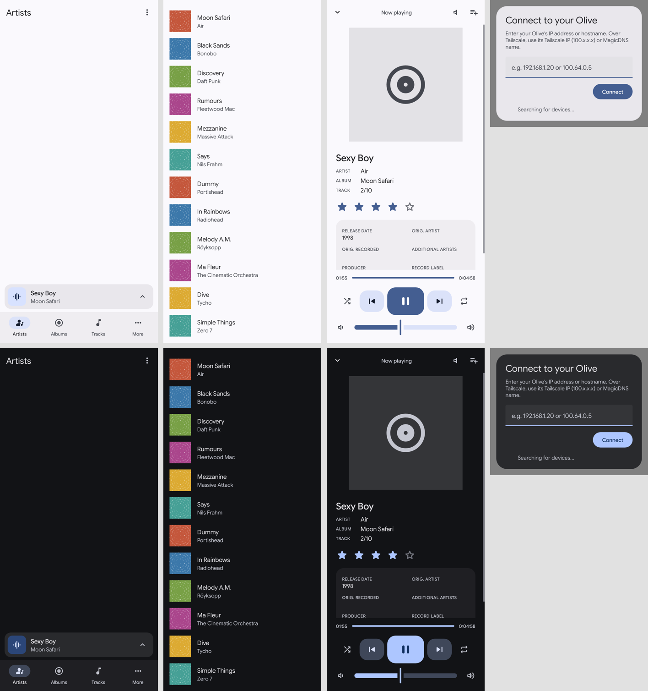

# OliveApp-Modern-Android

The official remote-control app for **Olive** network music players (Olive 4HD, O2M, Melody and others),
rescued from 2011 and rebuilt to install and run on modern Android, with a Material 3 / Android 16 look.

Olive's app was pulled from Google Play long ago. It targeted Android 1.6, so Android 14 and later refuse to install
it, and even where it installed it no longer worked. This project patches the original app rather than rewriting it,
so it sends the player exactly the same commands the original did.



## Download

Get the APK from [Releases](../../releases), copy it to your phone and open it (allow "Install unknown apps" when
prompted; if Play Protect warns about an unknown developer, choose **More details → Install anyway**).

Each release lists the APK's SHA-256 and the signing certificate fingerprint so you can check your download. All
releases from 1.0-modern.4 on are signed with the same key, so later versions install as updates.

Requires Android 6.0 or newer; designed for Android 14-16.

## Connecting to your Olive

- **On the Olive's Wi-Fi:** the app searches for the player automatically.
- **Anywhere else** (mobile data with Tailscale or another VPN): type the player's address into the connect box,
  e.g. its Tailscale IP (`100.x.x.x`), MagicDNS name, or LAN IP if your tailnet routes that subnet. Automatic
  search uses local multicast, so it can't work across a VPN.

## What was changed

| Problem on modern Android | Fix |
|---|---|
| Install blocked: no target SDK (Android 14+ requires 23/24+), v1-only signature | Targets API 34; signed with v1+v2+v3 |
| Crash on first launch: device search forced a Wi-Fi disconnect/reconnect, now refused with a SecurityException | Removed; any search error falls back to typing the address |
| Only worked on Wi-Fi: "no Wi-Fi IP" was treated as "no network" | Any active network (mobile data, Tailscale, ...) is accepted |
| Crashes on buttons (`NetworkOnMainThreadException`) | Restores the permissive thread policy the app was written for |
| Plain `http://` to the player blocked; Apache HttpClient removed from Android | Cleartext allowed; `org.apache.http.legacy` declared |
| `AsyncTask` became serial: one slow request froze every command and the now-playing poll | All 85 call sites run on the parallel executor, as on Android 1.x/2.x |
| Search / Refresh / Shuffle / Quit only reachable via the hardware MENU key | App bar search and ⋮ buttons |
| Artwork cache in shared storage (blocked by scoped storage); manifest invalid for API 31+ | Private cache; manifest updated |
| Voice search disabled on Android 11+ (package visibility) | `<queries>` entry for the speech recogniser |
| No way to see why it closed | Built-in crash reporter: the next launch shows the error with a Copy button |
| 2011 Android 1.x UI | Material 3 (below) |

### Material 3 / Android 16 design

- **Dynamic colour** from your wallpaper: the exact Material You roles on Android 14+, tonal palettes on 12-13, and
  an Olive-green M3 scheme on older versions. Light and dark follow the system.
- **Google Sans Flex** on the M3 type scale; **Material Symbols Rounded** icons.
- M3 navigation bar with animated indicator pill, floating now-playing card, rounded artwork, pill buttons, filled
  text fields, 28dp dialogs, M3 Expressive split-track slider and a shape-morphing play button.
- Emphasized-easing motion: tab fade-through, list items animating in, the player sliding up, press feedback.
- The Android 12+ splash screen and an adaptive, themed launcher icon.

The Material Components library isn't used (it's only on Google's Maven); all of this is built from framework
widgets, resources and a few helper classes.

## How it works

`build.sh` decodes [`original/OliveApp_1.0.apk`](original/) with apktool and applies three patch stages:

1. [`patches/patch_resources.py`](patches/patch_resources.py): manifest, permissions, SDK levels, adaptive icon.
2. [`patches/patch_ui.py`](patches/patch_ui.py): the Material 3 UI (colours, type, shapes, motion, layouts). The
   original code finds views by id and casts them, so this refuses to build if a redesigned layout drops or retypes
   any original view id.
3. [`patches/patch_smali.py`](patches/patch_smali.py): bytecode fixes, plus the helper classes in
   [`helpers/`](helpers/) (Java source in `helpers/src`, compiled smali in `helpers/smali`; regenerate with
   `helpers/build-helpers.sh`).

[`docs/original-decompiled/`](docs/original-decompiled/) has the original app's decompiled Java for reference.

### Building

Requires Java 17+, Python 3 with Pillow, [apktool 2.10.0](https://github.com/iBotPeaches/Apktool/releases) and
[uber-apk-signer 1.3.0](https://github.com/patrickfav/uber-apk-signer/releases).

```sh
APKTOOL=apktool_2.10.0.jar UBER_SIGNER=uber-apk-signer-1.3.0.jar \
OLIVE_KEYSTORE=/path/to/release.p12 OLIVE_KEYSTORE_PASS=... \
./build.sh out
```

The release key is never committed (see `.gitignore`); without `OLIVE_KEYSTORE` the APK is left unsigned in
`out/olive-unsigned.apk`. Builds are reproducible: the app code and resources match the release byte for byte.

### Testing

There's no emulator involved: [`test-harness/`](test-harness/) runs the app's real code under
[Robolectric](https://robolectric.org) (Android 14), against [`olive_server.py`](test-harness/olive_server.py), a
fake Olive serving sample data. It checks launch, the device picker without Wi-Fi, the crash reporter and the
artwork's rounded clipping, and renders every screen.

```sh
D2J=dex-tools-v2.4/d2j-dex2jar.sh test-harness/run-tests.sh out light   # or: dark
```

Screenshots of every screen are in [`docs/screenshots/`](docs/screenshots/). The simulator uses a default blue
wallpaper palette and can't draw rounded clipping or the real tab bar; on a phone, colours follow your wallpaper.

## Credits and licences

The original Olive app is © its original authors at Olive. Third-party assets bundled in the APK (Google Sans Flex, OFL 1.1;
Material Symbols, Apache 2.0) are listed in [`m3-assets/NOTICE.md`](m3-assets/NOTICE.md) with their licence texts.
